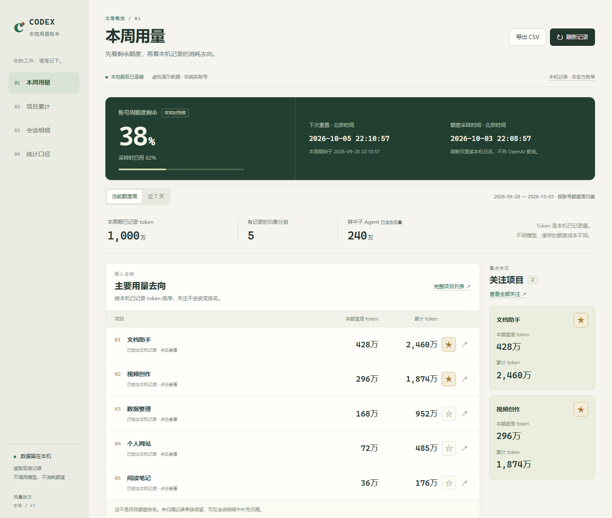
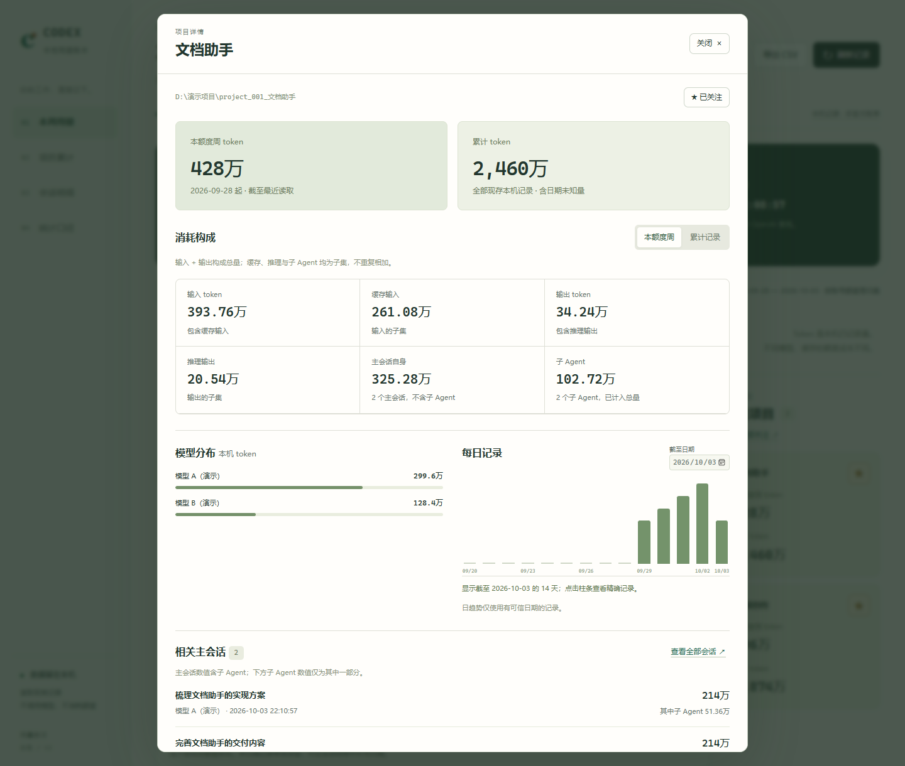

# Codex 用量看板

**把 Codex 的本地用量，整理成看得懂的项目账本。**

同时推进多个项目时，最想知道的通常是：**本周 token 主要用在哪些项目？一个项目从开始到现在累计用了多少？**

Codex 用量看板把散落在本机日志里的用量记录，汇总成中文可视化页面。账号周额度快照、项目本周记录和项目累计放在同一套看板中，帮助你在额度紧张时，有依据地安排后续工作的优先级。

无需 API Key，无需安装前端依赖。查看和刷新只读取已有本地记录，不调用模型，也不消耗模型额度。

> **统计边界：**项目排名依据本机已记录的 token；账号周额度来自日志快照。两者口径不同，不能把“某项目占 30% token”解释成“用掉 30% 周额度”。本项目不编造项目级扣额数字，也不是 OpenAI 官方产品。



*截图中的项目、用量和额度均为虚构演示数据。*

## 它能帮你看清什么

| 你想知道的事 | 看板提供的内容 |
|---|---|
| 本周主要用在哪些项目？ | 按当前账号额度周窗口汇总项目 token，按记录量排序，本周与累计并排展示 |
| 这个项目总共用了多少？ | 独立的「项目累计」视图，可搜索、排序，不随周范围切换而改变累计值 |
| 重点项目还有哪些值得继续投入？ | 星标关注，把重要项目的本周和累计用量留在首页，方便结合剩余额度自行安排工作 |
| 一个项目的用量由什么组成？ | 输入、缓存输入、输出、推理与子 Agent 记录，搭配模型分布和每日趋势 |
| 哪次会话产生了这些记录？ | 会话搜索、父子 Agent 关联、归属依据和人工归属修正 |
| 想再做自己的分析？ | 将当前范围的项目汇总导出为 CSV |

## 优点与特色

### 1. 围绕项目做决策，少在日志里找数字

首页先展示账号额度快照，再展示项目记录量与累计。你可以先了解整体余量，再比较工作投入，并将重要项目加入关注。看板提供决策参考，项目优先级由你掌握。

### 2. 本周与累计各有用途

本周用于比较近期投入；累计用于了解长期工作量。两种统计并排呈现，不用反复切换页面。周统计依据日志中的真实额度窗口；没有有效窗口时明确显示未知，也可主动切换到「近 7 天」。

### 3. 子 Agent 一起归集，保留可追溯的明细

子 Agent 跟随主会话归入项目，主会话同时展示含子 Agent 的总量。项目详情可以继续追溯模型、日期和相关会话。对于共享目录或跨项目会话，支持手工校正归属。

### 4. 重视计数口径，不把重复记录当新增消耗

对累计计数取增量，处理可识别的重复快照、继承历史与恢复余额。缓存输入、推理输出和子 Agent 用量作为子集展示，不重复加总。缺失、异常或日期不可信的记录会保留边界说明，避免用看似精确的数字掩盖未知。

### 5. 数据留在本机，日常查看不再花额度

服务只监听 `127.0.0.1`，不需要连接模型 API，不读取认证文件，不向外上传用量。缓存保存统计所需的用量和会话元数据，不保存聊天正文。个人配置、缓存、项目归属与运行日志默认排除在 Git 提交之外。

### 6. 轻量、中文、随时打开

Python 标准库后端，原生 HTML / CSS / JavaScript 前端，无需 `pip install` 或 `npm install`。提供 Windows 启动与停止入口，中文界面使用「万 / 亿」展示大数字，悬停可查看精确值，兼顾桌面和窄窗口。



*同样为虚构演示数据，不对应任何真实用户。*

## 快速开始

当前主要验证环境是 **Windows + Python 3.10 或更新版本**。你需要已在本机使用过 Codex，并保留相应的本地用量日志。没有日志也可以打开页面，但不会凭空生成用量。

### 第一步：下载

在仓库上方选择 **Code → Download ZIP**，解压到你希望保存工具的目录；或使用 Git：

```powershell
git clone https://github.com/willwu0826/codex-usage-dashboard.git
cd codex-usage-dashboard
```

### 第二步：设置项目目录

将根目录的 `config.example.json` 复制为 `config.json`，将 `workspace` 改为你的项目总目录。例如：

```json
{
  "workspace": "D:/我的项目"
}
```

支持识别 `项目总目录/project_*`，以及 `项目总目录/一级分类/project_*`。项目目录名称不符合这个规则时，可以在 `projects` 中明确列出完整路径。配置中的 Windows 路径建议用 `/`，避免 JSON 反斜杠转义问题。

Codex 数据目录默认使用 `CODEX_HOME` 环境变量；未设置时使用当前用户的 `.codex` 目录。自定义数据目录可用 `codex_home` 指定。配置示例及更多可选项见 [配置说明](docs/配置说明.md)。

### 第三步：打开看板

双击 **`打开看板.vbs`**，浏览器将打开：

[http://127.0.0.1:43129](http://127.0.0.1:43129)

如果系统禁用了 VBS，或者需要查看启动错误，在项目目录运行：

```powershell
python -B .\02_实现\server.py
```

首次读取后即可查看。Codex 产生新记录时，点击页面右上角的「刷新记录」更新账本；刷新不会主动查询官方额度。

通过启动脚本运行的服务，可右键 `停止用量看板.ps1` 选择「使用 PowerShell 运行」停止。通过上面的命令前台运行时，按 `Ctrl+C` 停止。

## 四个页面，四种查看方式

| 页面 | 用途 |
|---|---|
| **本周用量** | 额度快照与重置时间、项目记录量排名、重点项目 |
| **项目累计** | 所有已识别项目、本周与累计对比、搜索与关注筛选 |
| **会话明细** | 主会话与子 Agent、模型信息、时间筛选、归属补录 |
| **统计口径** | 计算规则、数据覆盖、重复排除、读取异常及未知部分 |

点击任意项目，可打开详情查看用量构成、模型分布、每日趋势和相关会话。

## 数字应该怎么理解

- **总 token = 输入 token + 输出 token。**缓存输入包含在输入中，推理包含在输出中，子 Agent 已包含在项目总量中，不能再加一次。
- **只覆盖这台电脑仍保留的记录。**云端或其他设备没有同步到本机的记录不在项目账本中；账号额度快照可能覆盖更广范围。
- **额度是快照，不是实时查询。**过旧时会提示；重置后没有新快照时显示未知。额度规则请以 [OpenAI 官方说明](https://learn.chatgpt.com/docs/pricing) 为准。
- **日期未知只计累计。**无法可靠还原日期的历史记录不硬塞进某个周或每日趋势。
- **没有检出记录不等于没有消耗。**目录可能存在，但对应日志缺失或尚未归属。
- **跨项目聊天按整段主会话归属。**目前不自动把同一主会话切成多个项目；必要时请人工核对。

本项目不提供官方项目级额度扣减、精确费用账单、异常审核或自动限额分配。Codex 日志格式变化也可能影响识别，出现读取异常时可在「统计口径」查看覆盖信息。

## 技术与目录

```text
02_实现/
  usage_core.py       日志解析、缓存、项目归集与计量
  server.py           本机 HTTP 服务与 CSV 导出
  web/                中文可视化界面
tests/                使用合成数据的回归测试
docs/                 配置说明与演示截图
config.example.json   可公开的通用配置示例
03_数据/              运行时生成，仅留本机，已忽略
```

运行自动化测试：

```powershell
python -B -m unittest discover -s tests -v
```

反馈功能建议或问题时，可使用仓库的 [Issues](https://github.com/willwu0826/codex-usage-dashboard/issues)。请先去掉会话内容、个人路径与认证信息，再提交最小复现材料。
